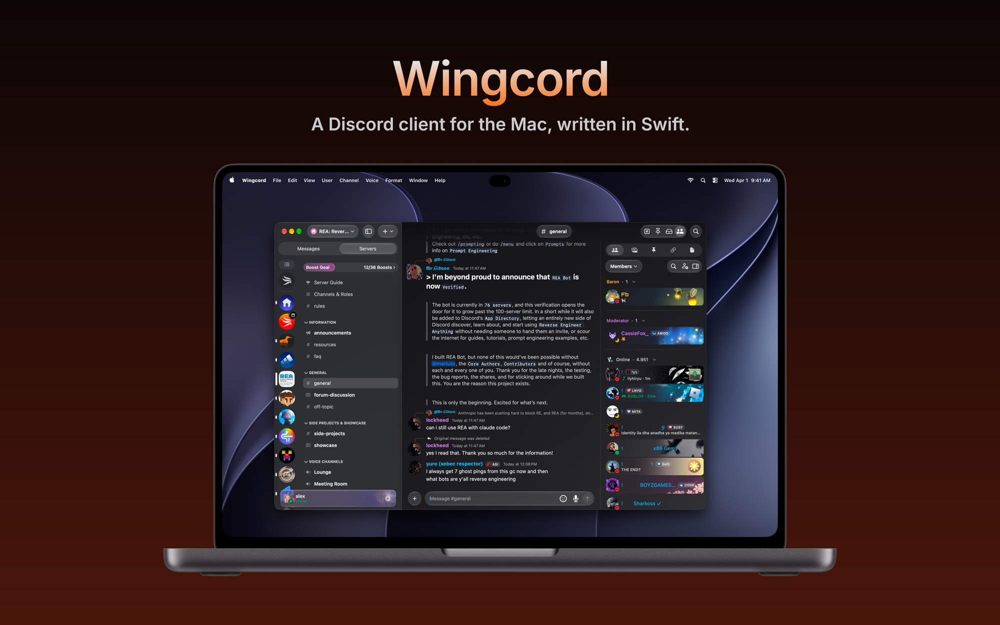

# Wingcord



A Discord client for the Mac, written in Swift for macOS 27. It's in beta, and the current release is 1.0 Beta 1.

[Download Wingcord](https://download.wingcord.app/Wingcord.dmg) · [Report a bug](https://github.com/WingcordApp/wingcord/issues)

Wingcord is a native Mac app. Most of it is SwiftUI with Liquid Glass, and it draws the message list and the member list with AppKit, because composing a SwiftUI view for every message and every member costs too much once a channel or a server gets busy. You sign in with your own Discord account, and calls work as they do in Discord, including its end-to-end encryption for voice and video.

## Install

1. Download `Wingcord.dmg`, open it and drag Wingcord into Applications.
2. Open Wingcord. The first time, macOS won't open it, because it isn't notarized by Apple. Click **Done** (not Move to Trash), then go to **System Settings > Privacy & Security**, scroll down and click **Open Anyway**.
3. Sign in with your password and two-factor code, or scan the QR code with Discord on your phone.

Updates download in the background and install when you quit. After each one, macOS asks for your Mac's password once before Wingcord can read its saved sign-in from the Keychain; click **Always Allow**. That prompt comes from macOS. Wingcord signs its releases with a certificate of its own, and macOS doesn't carry Keychain access over to a new version of an app signed that way.

## Build from source

You need macOS 27 and Xcode with Swift 6.4.

```sh
git clone https://github.com/WingcordApp/wingcord.git
cd wingcord
scripts/run-demo.sh     # a debug build that runs on sample data, with no account
scripts/build-app.sh    # a release build, at build/Wingcord.app
```

The tests are split by package:

```sh
swift test
swift test --package-path Packages/WingcordCore
swift test --package-path Packages/WingcordNet
swift test --package-path Packages/WingcordVoice
```

`build-app.sh` signs with your "Apple Development" certificate if you have one, and ad-hoc if you don't. An ad-hoc build runs fine, but macOS sees every rebuild as a different app, so it asks again for Keychain access and for camera and microphone permission.

The sign-in screen in official builds uses an effect adapted from [MetalForge](https://metalforge.xyz), whose license doesn't allow publishing its code. A build from this repository draws its own background there instead; nothing else differs.

## Reporting bugs

Report bugs from inside Wingcord if you can: **Help > Report a Bug…**, or type `/bug` in any message box. The report says what Wingcord was doing, without names, messages, addresses or tokens, and **See What's Sent…** shows every file before it leaves your Mac. You get a number like `WC-4F2K` to follow it by. You can also open an issue here on GitHub.

## Contributing

Pull requests are welcome. [CONTRIBUTING.md](CONTRIBUTING.md) explains how to build and test a change, and how pull requests are merged.

## License

Wingcord is free software under the GNU General Public License, version 3 or any later version; see [LICENSE](LICENSE). Code and fonts from other projects keep their own licenses, listed in [THIRD-PARTY-NOTICES.md](THIRD-PARTY-NOTICES.md).

## Not affiliated with Discord

Discord Inc. doesn't make or endorse Wingcord. Discord's Terms of Service don't allow third-party clients, and accounts can be actioned for using one, so use Wingcord at your own risk.
